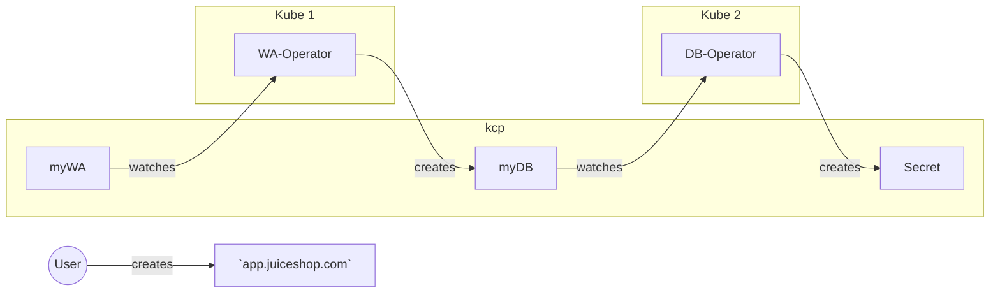

# App Operator

Simple App Operator, which is bundled together with a database operator.

It watches `app.juiceshop.com` objects and creates the necessary database objects.

## Rough Whiteboard Drawing

